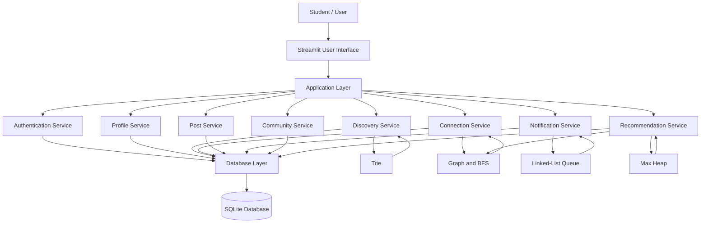

# UniSphere – System Architecture

## Architecture Explanation

1. **Presentation Layer:** Streamlit provides the user interface.
2. **Application Layer:** Services handle authentication, profiles, connections, posts, notifications and communities.
3. **DSA Layer:** Custom data structures support searching, network traversal, notification queue operations and recommendation ranking.
4. **Database Layer:** SQLite stores application data persistently.

The application follows a modular architecture that separates the user interface, business logic, data structures and database operations.
