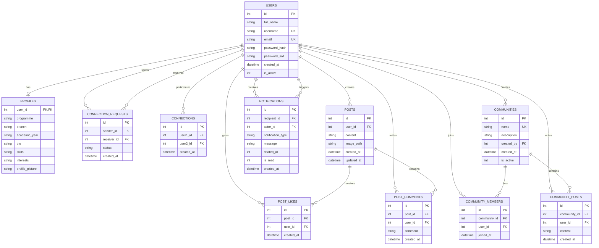

# UniSphere – Database ER Diagram

## Entity Relationship Diagram

## Database Explanation

### 1. Users and Profiles
Each registered student has an account. A profile stores additional academic and personal information.

### 2. Connections
Connection requests store pending requests between students. Accepted connections are stored separately using two user IDs.

### 3. Student Feed
Posts are connected to their authors. Likes and comments are stored in separate tables.

### 4. Notifications
Notifications identify the recipient and the user who triggered the activity.

### 5. Communities
Students can create communities, join communities and publish discussions.

## Database Design

UniSphere uses a relational SQLite database with primary keys, foreign keys and unique constraints to maintain data consistency.
